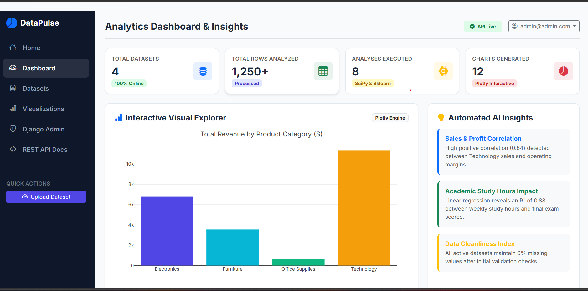
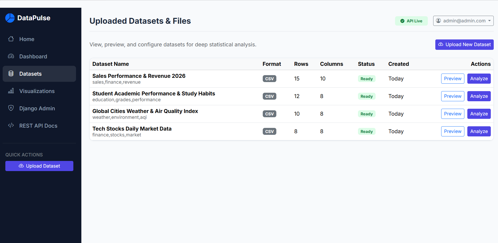
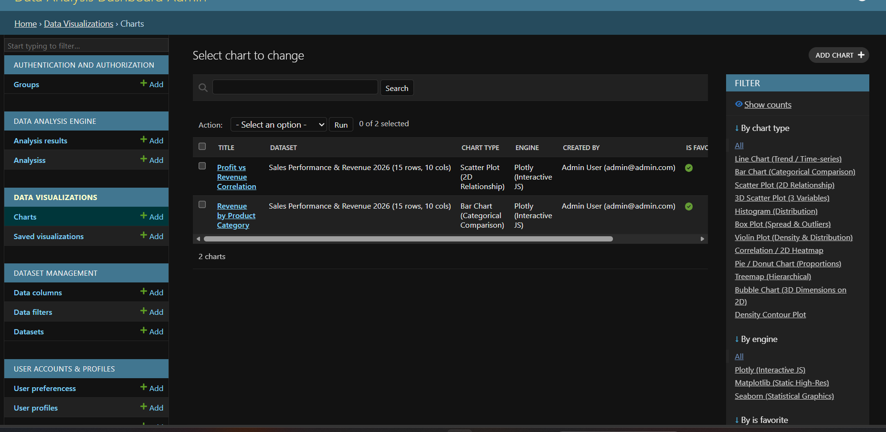
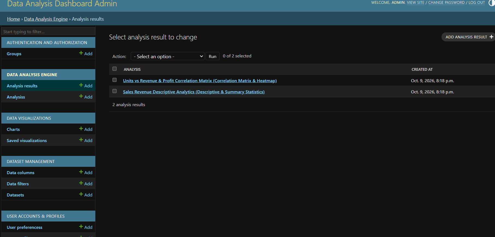

# DataPulse - Data Analysis & Visualization Dashboard

A full-stack Data Analysis & Visualization Dashboard built with **Django 6.1**, **Django REST Framework (DRF)**, **Pandas**, **SciPy**, **Scikit-Learn**, **Plotly**, and **Seaborn**.

Upload a dataset, get an automatic profile of its contents, run statistical and machine-learning analyses, and explore the results through interactive charts.

---

## 📸 Screenshots

### Dashboard


### Datasets


### Interactive Charts


### Analysis Results


---

## 🌟 Key Features

- 📁 **Dataset Management**: Upload and parse CSV, Excel (.xlsx), and JSON files.
- 🔍 **Automated Data Profiling**: Extracts column types, missing values, duplicates, skewness, kurtosis, and summary stats.
- 📐 **Statistical Analysis Engine**:
  - Full descriptive statistics (mean, median, variance, IQR, quantiles).
  - Pearson & Spearman correlation matrices with heatmap rankings.
  - Outlier detection via **IQR (Interquartile Range)** and **Z-Score** algorithms.
  - **Machine Learning**: K-Means clustering with cluster profiling, Principal Component Analysis (PCA), and Linear Regression.
  - Automated insights and data-cleaning recommendations.
- 📊 **Dynamic Visualizations**:
  - Interactive **Plotly** charts (Line, Bar, Scatter, 3D Scatter, Histogram, Box, Violin, Pie, Treemap, Bubble, Heatmap).
  - Static image export in PNG, SVG, and PDF via **Seaborn & Matplotlib**.
- 🛡️ **Authentication & Permissions**: Custom User model, JWT tokens (SimpleJWT), Session auth, role-based dataset access control.
- ⚡ **Background Tasks (optional)**: Redis cache and Celery are configured for long-running tasks, and are disabled by default.
- 🎨 **Responsive UI**: Bootstrap 5 dashboard with responsive charts and dark/light theme support.

---

## 🏗️ Project Architecture

```
data-analysis-dashboard/
├── config/                 # Root settings, URLs, ASGI/WSGI, Celery config
├── accounts/               # CustomUser, UserProfile, UserPreferences, Auth APIs
├── datasets/               # File uploads, parsers, DataColumn, DataSample, profiler
├── analysis/               # DataAnalyzer engine (SciPy/Sklearn/Pandas), Analysis models
├── visualizations/         # ChartGenerator (Plotly & Seaborn), Chart configs, Export API
├── api/                    # Consolidated API root, system health, and metrics
├── templates/              # Bootstrap 5 templates (Home, Dashboard, Datasets, Charts)
├── static/                 # Stylesheets, JavaScript, Chart utilities
├── sample_data/            # Sample datasets
├── tests/                  # Automated unit and integration tests
├── requirements.txt        # Dependencies
├── manage.py
├── .env.example            # Environment variables template
├── README.md
├── API.md
└── FEATURES.md
```

---

## 🚀 Quick Start Guide

**Requirements:** Python 3.15 (tested) and Git.

### 1. Clone & Navigate
```bash
git clone https://github.com/aldhyanifaris-cell/data-analysis-dashboard.git
cd data-analysis-dashboard
```

### 2. Set Up Virtual Environment
```bash
python -m venv venv
# Windows:
.\venv\Scripts\activate
# Linux/macOS:
source venv/bin/activate
```

### 3. Install Dependencies
```bash
pip install -r requirements.txt
```
> The installation downloads large scientific packages (pandas, SciPy, scikit-learn) and may take several minutes.

### 4. Configure Environment
```bash
# Windows:
copy .env.example .env
# Linux/macOS:
cp .env.example .env
```

Generate a secret key and paste it as the value of `SECRET_KEY` in `.env`:
```bash
python -c "from django.core.management.utils import get_random_secret_key; print(get_random_secret_key())"
```

> `SECRET_KEY` is required: the app will not start without it. `DEBUG` defaults to `False`, so keep `DEBUG=True` in `.env` for local development.

### 5. Database Setup & Seeding
```bash
python manage.py migrate
python manage.py seed_analysis_data
```

### 6. Run the Server
```bash
python manage.py runserver
```

Open your browser at: **http://127.0.0.1:8000/**

- **Django Admin:** http://127.0.0.1:8000/admin/ (email: `admin@admin.com`, password: `Admin1234!`)
- **REST API Explorer:** http://127.0.0.1:8000/api/v1/

> ⚠️ The admin account is created by the seed command with a known demo password. For local development only; never use it in production.

---

## ⚙️ Optional Services

By default the app runs with SQLite and no external services.

| Feature | Setting in `.env` | Requires |
|---|---|---|
| PostgreSQL | `USE_POSTGRES=True` + `DB_NAME`, `DB_USER`, `DB_PASSWORD`, `DB_HOST`, `DB_PORT` | A running PostgreSQL server |
| Redis cache | `USE_REDIS_CACHE=True` + `REDIS_URL` | A running Redis server |
| Background tasks | `CELERY_BROKER_URL`, `CELERY_RESULT_BACKEND` | Redis and a Celery worker |

> When `USE_POSTGRES=True`, `DB_PASSWORD` is required.

---

## 📚 Documentation

- [API reference](API.md)
- [Features overview](FEATURES.md)

---

## 🧪 Running Tests

```bash
python manage.py test tests
```

---

## 👤 Author

Faris Al-Dhyani — [GitHub](https://github.com/aldhyanifaris-cell)

---

## 📄 License

This project is licensed under the MIT License.